# ambientCG: Metal materials

**21 assets from [ambientCG](https://ambientcg.com), dedicated to the public domain under [CC0](https://docs.ambientcg.com/license/).** Use them in any game, free or paid, and change them however you like; no credit is needed.

PBR materials as 1K and 2K JPG maps (colour, normal GL and DX, roughness, AO, displacement), one folder per resolution. 375.2 MB in all.

This is a copy kept by [zuujis-cc0](https://github.com/zuujis-cc0) so game makers can take single files from GitHub. It is not made by or affiliated with ambientCG: the originals, often in more formats and higher resolutions, are on [ambientcg.com](https://ambientcg.com). If they help you, consider [supporting ambientCG](https://www.patreon.com/ambientCG).

Every file is listed in [MANIFEST.tsv](MANIFEST.tsv) with its size and SHA-256. More free assets: [the Zuujis collection](https://github.com/zuujis-cc0/free-game-assets#readme).

| | | | |
| :-: | :-: | :-: | :-: |
| <a href="Metal056C">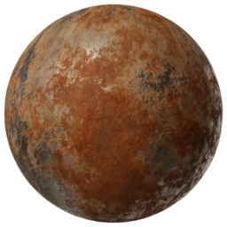</a> <b><a href="Metal056C">Metal 056 C</a></b> by ambientCG · <a href="https://ambientcg.com/a/Metal056C">source</a> | <a href="Metal057A">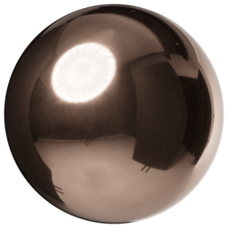</a> <b><a href="Metal057A">Metal 057 A</a></b> by ambientCG · <a href="https://ambientcg.com/a/Metal057A">source</a> | <a href="Metal057B">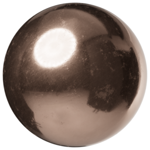</a> <b><a href="Metal057B">Metal 057 B</a></b> by ambientCG · <a href="https://ambientcg.com/a/Metal057B">source</a> | <a href="Metal057C">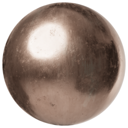</a> <b><a href="Metal057C">Metal 057 C</a></b> by ambientCG · <a href="https://ambientcg.com/a/Metal057C">source</a> |
| <a href="Metal058A">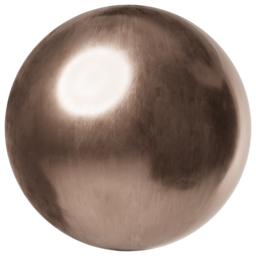</a> <b><a href="Metal058A">Metal 058 A</a></b> by ambientCG · <a href="https://ambientcg.com/a/Metal058A">source</a> | <a href="Metal058B">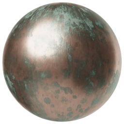</a> <b><a href="Metal058B">Metal 058 B</a></b> by ambientCG · <a href="https://ambientcg.com/a/Metal058B">source</a> | <a href="Metal058C">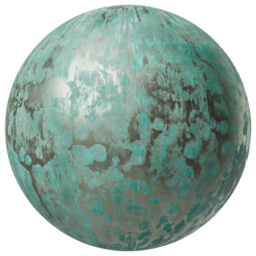</a> <b><a href="Metal058C">Metal 058 C</a></b> by ambientCG · <a href="https://ambientcg.com/a/Metal058C">source</a> | <a href="Metal059A">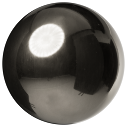</a> <b><a href="Metal059A">Metal 059 A</a></b> by ambientCG · <a href="https://ambientcg.com/a/Metal059A">source</a> |
| <a href="Metal059B">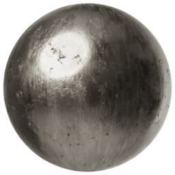</a> <b><a href="Metal059B">Metal 059 B</a></b> by ambientCG · <a href="https://ambientcg.com/a/Metal059B">source</a> | <a href="Metal059C">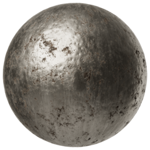</a> <b><a href="Metal059C">Metal 059 C</a></b> by ambientCG · <a href="https://ambientcg.com/a/Metal059C">source</a> | <a href="Metal060A">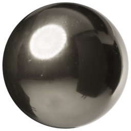</a> <b><a href="Metal060A">Metal 060 A</a></b> by ambientCG · <a href="https://ambientcg.com/a/Metal060A">source</a> | <a href="Metal060B">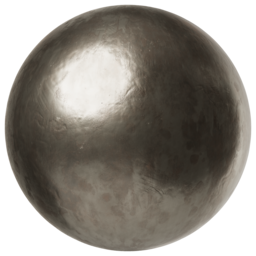</a> <b><a href="Metal060B">Metal 060 B</a></b> by ambientCG · <a href="https://ambientcg.com/a/Metal060B">source</a> |
| <a href="Metal060C">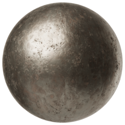</a> <b><a href="Metal060C">Metal 060 C</a></b> by ambientCG · <a href="https://ambientcg.com/a/Metal060C">source</a> | <a href="Metal061A">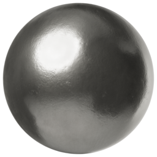</a> <b><a href="Metal061A">Metal 061 A</a></b> by ambientCG · <a href="https://ambientcg.com/a/Metal061A">source</a> | <a href="Metal061B">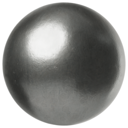</a> <b><a href="Metal061B">Metal 061 B</a></b> by ambientCG · <a href="https://ambientcg.com/a/Metal061B">source</a> | <a href="Metal061C">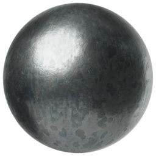</a> <b><a href="Metal061C">Metal 061 C</a></b> by ambientCG · <a href="https://ambientcg.com/a/Metal061C">source</a> |
| <a href="Metal062A">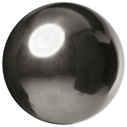</a> <b><a href="Metal062A">Metal 062 A</a></b> by ambientCG · <a href="https://ambientcg.com/a/Metal062A">source</a> | <a href="Metal062B">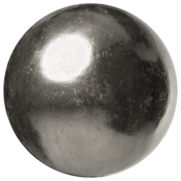</a> <b><a href="Metal062B">Metal 062 B</a></b> by ambientCG · <a href="https://ambientcg.com/a/Metal062B">source</a> | <a href="Metal062C">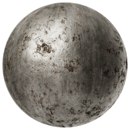</a> <b><a href="Metal062C">Metal 062 C</a></b> by ambientCG · <a href="https://ambientcg.com/a/Metal062C">source</a> | <a href="Metal063">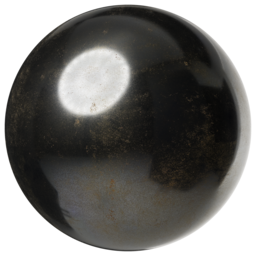</a> <b><a href="Metal063">Metal 063</a></b> by ambientCG · <a href="https://ambientcg.com/a/Metal063">source</a> |
| <a href="Metal064">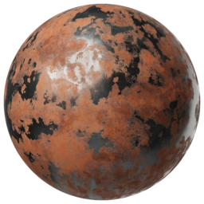</a> <b><a href="Metal064">Metal 064</a></b> by ambientCG · <a href="https://ambientcg.com/a/Metal064">source</a> |  |  |  |

---

Kept up to date by this repository's own [update workflow](.github/workflows/update.yml), with code and plan from [cc0-mirror](https://github.com/zuujis-cc0/cc0-mirror). Something wrong? [Open an issue there](https://github.com/zuujis-cc0/cc0-mirror/issues/new) or use the [private report form](https://games.zuujis.com/report).
